# Atelier

Application Android pour préparer ses travaux sans erreur : coupes, quantités et budget d'un chantier, de la pièce saisie mur par mur jusqu'au bilan de fin de chantier.

Tout reste sur le téléphone, sans compte ni connexion : l'appli n'a pas la permission Internet.

## Sur iPhone

Atelier existe aussi en version web : https://remiverhaeghe.github.io/atelier/. Dans Safari, bouton Partager, puis « Sur l'écran d'accueil » : l'appli s'ouvre alors en plein écran, comme une appli installée, et marche hors ligne après la première ouverture. Chantiers, photos et stock de l'atelier restent dans le navigateur de l'iPhone. Pour passer d'un appareil à l'autre : exporter le chantier (ou la sauvegarde complète) par le menu de partage, puis l'importer depuis l'app Fichiers. Le télémètre Bluetooth, les rappels programmés et le widget ne sont disponibles que sur Android pour l'instant.

## Langues

L'appli est en français et en anglais (`lib/l10n/app_fr.arb`, modèle des textes, et `app_en.arb`). Elle suit la langue du téléphone ; « À propos » permet de forcer l'une ou l'autre. Un test vérifie que chaque texte français a sa traduction, avec les mêmes paramètres. Les tests d'écran tournent en français (`test/flutter_test_config.dart`). Limites : les commandes vocales restent en français, et les normes, aides et règles citées sont celles de la France.

## Aperçu

| Chantier | Reprises | Parquet | Plan de pose | Plinthes |
|---|---|---|---|---|
|  | 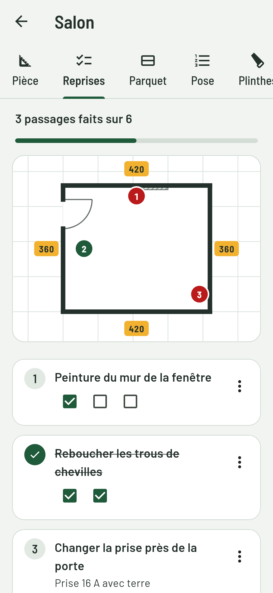 |  |  | 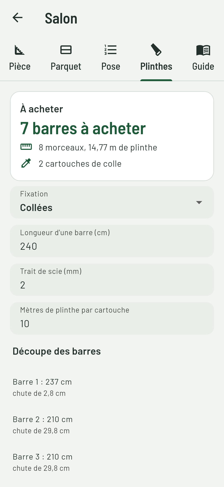 |

| Peinture | Conseil | Calculs | Étagère |
|---|---|---|---|
|  | 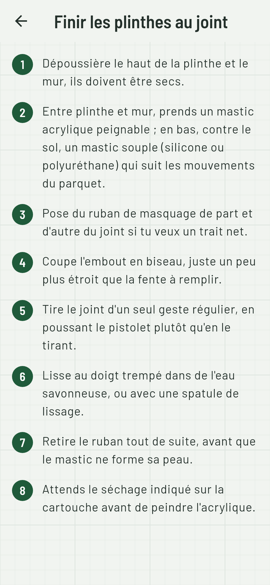 |  | 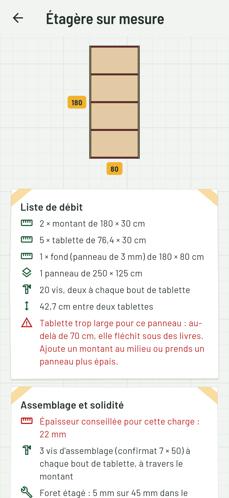 |

| Pièce sous rampants | Fenêtre bois | Faux plafond | Placard sous rampant | Scier droit |
|---|---|---|---|---|
| 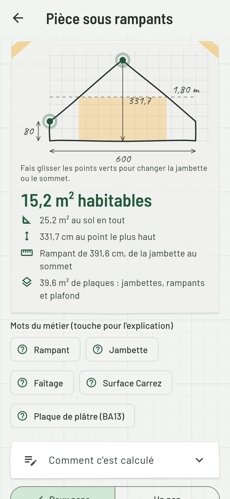 | 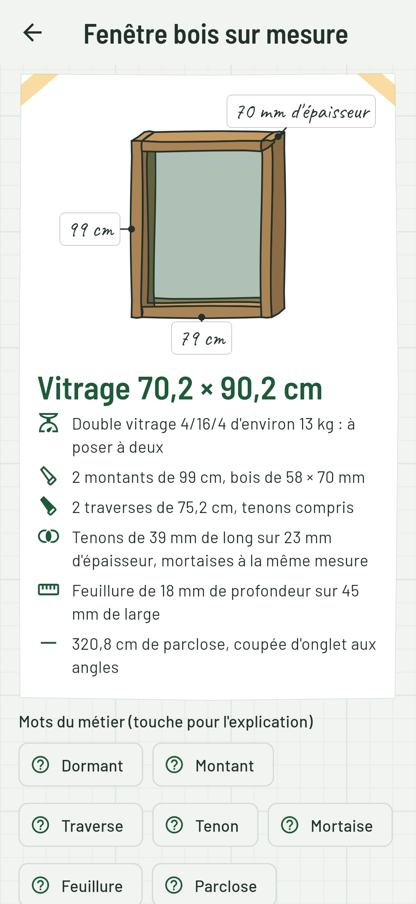 | 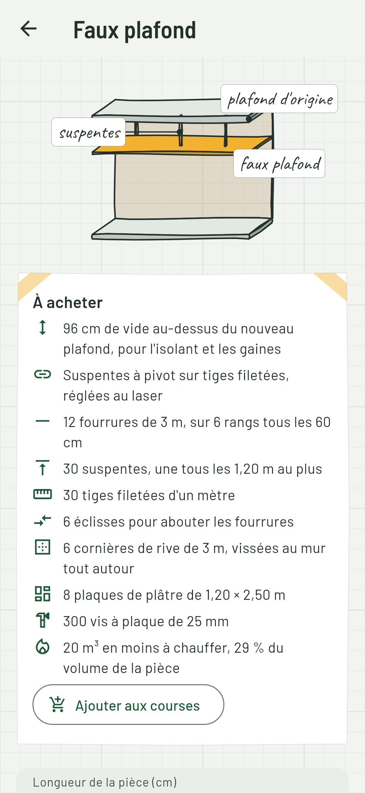 | 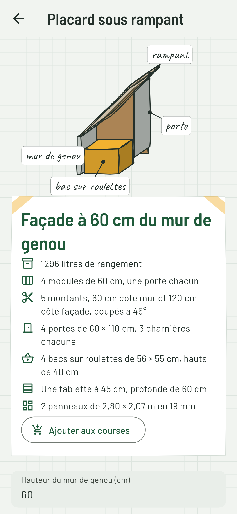 | 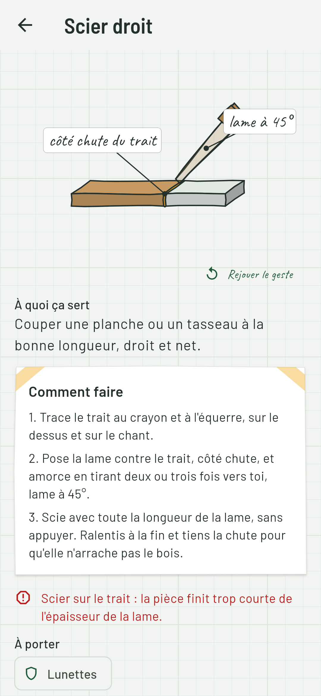 |

| Dessin de la pièce | Mezzanine en L | Suivi de l'humidité |
|---|---|---|
| 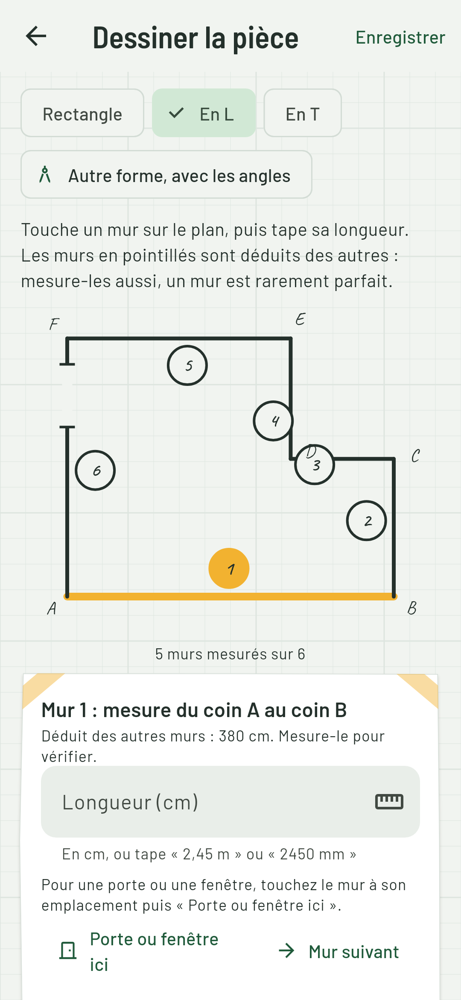 | 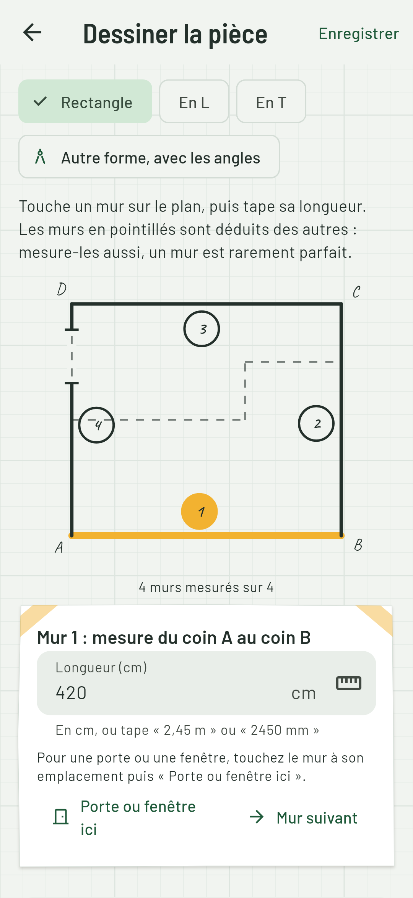 | 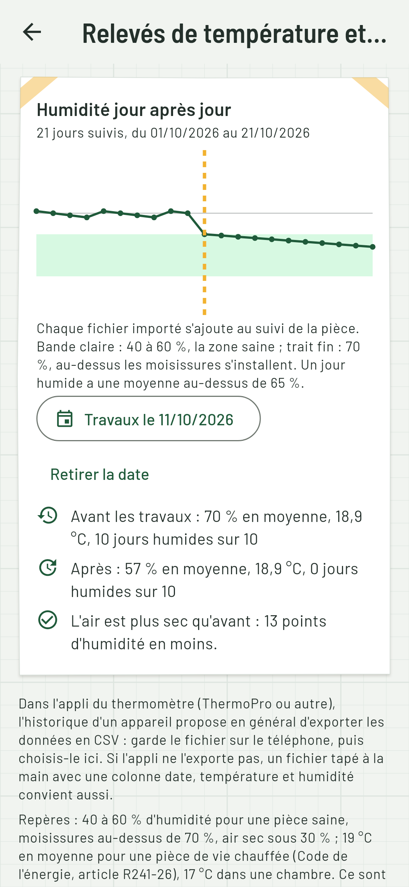 |

Captures faites sur un chantier fictif par le workflow Captures (`test/captures/`), à chaque changement d'interface. Les nouvelles versions sont dans l'artefact `captures` de son dernier passage. Le portfolio recopie celles de `docs/captures/` à chaque publication : un nom de fichier qui change doit y être reporté.

## Ce que fait l'appli

Le détail, version par version, est dans [CHANGELOG.md](CHANGELOG.md).

| Domaine | Contenu |
|---|---|
| Pièces et plan | Dessin d'après une forme (rectangle, L, T) aux murs numérotés, murs non mesurés déduits et rappelés en mode chantier, portes et fenêtres posées d'un toucher, saisie mur par mur ou décalque d'un plan papier qui propose la forme, fiche de la pièce à imprimer, plafonds rampants à un ou deux pans, plusieurs niveaux et mezzanine (en L autour de l'escalier), plan de la maison, vue 3D avec les meubles, export glTF et Home Assistant |
| Parquet et plinthes | Quantités, plan de pose rangée par rangée, diagonale et point de Hongrie, coupes de plinthes en schéma, barres optimisées, chutes réutilisables, mode chantier avec lecture à voix haute et commandes vocales, mode atelier en plein écran avec chronomètre, outils prêtés et loués avec rappel de retour, coût réel face à un artisan, comparaison de devis, le bon outil à acheter, louer ou emprunter |
| Calculs | Peinture (et grandes hauteurs), carrelage et mosaïque (sept poses dessinées dans la pièce) et faïence, placo et isolation, isolation phonique, enduit et ragréage, préparation des sols (chape, sous-couche, joints), électricité, plomberie, ventilation, chauffage, douche de plain-pied, cuisine, escalier, porte (jeu sous la porte, poignée, sens), charpente et couverture, fenêtre de toit, fenêtre bois et son étanchéité, essences de bois, finitions (lasure, vernis, vitrificateur, huile, cire), humidité et condensation, faux plafond, placard sous rampant, façade et clôture, terrasse, jardin, étagère, armoire, chevilles, soudure, gravats |
| Chantier | Budget, courses par magasin, dépenses et tickets, échéancier, planning, temps passé, objectif du jour, attentes avec notification, widget d'écran d'accueil, carnet de la maison en PDF, souvenirs du chantier en diaporama ou en PDF, partage d'un projet chiffré avec ses photos, avant / après, bilan, recherche dans toute l'appli, chantier partagé par fusion d'exports |
| Aide | Projets prêts à suivre (étagère, châssis fixe, mezzanine, embrasure) avec débit, courses et étapes, gestes de base animés, avec pause et ralenti (scier, raboter, percer, visser, poncer, mortaiser, mastic, cheville, placo, onglet, laser, joints de carrelage), caisse à outils du débutant, lexique des mots du métier avec schémas en relief, conseils et tutos, erreurs fréquentes, sécurité avant de commencer, réseaux cachés, faire soi-même ou faire faire, niveau et pente au téléphone, mesure par photo avec une carte ou une feuille A4 |
| Parquet et plinthes | Quantités, plan de pose rangée par rangée, diagonale et point de Hongrie, coupes de plinthes en schéma, barres optimisées, chutes réutilisables, mode chantier avec lecture à voix haute et commandes vocales |
| Calculs | Relevés d'un thermo-hygromètre analysés et suivis jour par jour (avant et après travaux, ou deux pièces face à face), peinture, carrelage et faïence, placo et isolation, isolation phonique, enduit et ragréage, électricité, plomberie, ventilation, chauffage, douche de plain-pied, cuisine, escalier, porte, charpente et couverture, fenêtre de toit, fenêtre bois et son étanchéité, essences de bois, finitions (lasure, vernis, vitrificateur, huile, cire), humidité et condensation, faux plafond, placard sous rampant, façade et clôture, terrasse, jardin, étagère, armoire, chevilles, soudure, gravats, débit d'un projet entier dans les bois et panneaux du commerce, escalier en relief avec l'échappée, soleil par une fenêtre de toit, charges en objets du quotidien, isolation des murs par l'intérieur avec la surface perdue, diagnostic thermique et rénovation énergétique pas à pas, électricité avec prises et éclairage placés sur le plan de chaque pièce, douche de plain-pied et salle d'eau (volumes de sécurité, pente, étanchéité liquide), cuisine (triangle d'activité, hotte, implantation), panneaux, colles et serrage |
| Chantier | Budget, courses par magasin, stock de l'atelier commun aux chantiers avec alertes de rachat, dépenses et tickets, échéancier, planning, temps passé, objectif du jour, attentes avec notification, widget d'écran d'accueil, carnet de la maison en PDF, avant / après, bilan, recherche dans toute l'appli, chantier partagé par fusion d'exports, dossier de revente (réseaux, solives, photos avant fermeture, références posées) |
| Aide | Gestes de base animés (scier, raboter, percer, visser, poncer, mortaiser, mastic, cheville, placo, onglet, laser, joints de carrelage), caisse à outils du débutant, défauts du bois à repérer au magasin, lexique des mots du métier avec schémas en relief, conseils et tutos, erreurs fréquentes, sécurité avant de commencer, réseaux cachés, faire soi-même ou faire faire, niveau et pente au téléphone, par où commencer (niveau, outils, temps et erreurs par type de travaux), contrôles qualité à cocher avec photo, sécurité par outil, « je me suis trompé », mode apprentissage avec petits défis, bruit et voisinage |

La suite est dans [ROADMAP.md](ROADMAP.md). Le format du plan exporté est décrit dans [docs/format-plan.md](docs/format-plan.md), l'export pour Home Assistant dans [docs/home-assistant.md](docs/home-assistant.md).

## Installer sur le téléphone

Chaque fusion sur `main` publie l'APK dans une préversion `build-N` de [Releases](../../releases) (les trois dernières sont gardées). Le plus simple pour l'installer et la tenir à jour est [Obtainium](https://github.com/ImranR98/Obtainium), une appli Android gratuite qui suit les releases GitHub :

1. Installer Obtainium depuis sa page GitHub (fichier `app-arm64-v8a-release.apk` de sa dernière release) ou depuis F-Droid.
2. Dans Obtainium, « Ajouter une appli », coller `https://github.com/Remiverhaeghe/atelier`.
3. Cocher « Inclure les préversions » puis « Ajouter ». Obtainium choisit l'APK du processeur du téléphone (arm64 pour un téléphone récent).
4. « Installer ». Ensuite, Obtainium signale chaque nouvelle construction et la met à jour en un clic.

Le numéro de construction sert de `versionCode` : chaque APK remplace la précédente sans désinstaller, données gardées. Les préversions ne sont publiées qu'avec la clé de signature personnelle (secrets `ANDROID_*`), sinon deux APK successives n'auraient pas la même signature.

Les versions numérotées (`vX.Y.Z`) ont leurs APK sur leur page de release, et chaque exécution de la CI garde aussi son APK en artefact `atelier-apk` (onglet Actions).

## Publier une version

1. Dans `CHANGELOG.md`, renommer `## Non publié` en `## X.Y.Z - AAAA-MM-JJ` et augmenter `version:` dans `pubspec.yaml` (le nombre après `+` à chaque fois).
2. Sur GitHub, Releases, « Draft a new release », nouveau tag `vX.Y.Z` sur `main`, puis « Publish release ».
3. La CI construit les APK et le bundle `.aab` depuis le tag et les joint à la release.

Permissions de l'appli et ce qu'elles servent : [docs/securite.md](docs/securite.md).

Pour le Play Store : liste à cocher dans [docs/publication-play-store.md](docs/publication-play-store.md), politique de confidentialité dans [docs/confidentialite.md](docs/confidentialite.md), images de la fiche dans `docs/play-store/` (`python tool/fiche_play.py`).

## Lancer en développement

Prérequis : Flutter 3.47 et le SDK Android.

```
flutter create --platforms=android --org fr.remiverhaeghe --project-name atelier .
flutter pub get
flutter run
```

La première commande recrée les fichiers Android qui ne sont pas versionnés (Gradle, icônes, `MainActivity`) ; elle ne touche pas au code existant, dont le widget d'écran d'accueil. Pour l'icône et l'écran de démarrage : `dart run flutter_launcher_icons` puis `dart run flutter_native_splash:create`.

## Tester

```
flutter gen-l10n
dart format lib test
flutter analyze
flutter test --coverage
```

Les captures d'écran sont sautées par `flutter test`. Pour les refaire : `flutter test --tags captures --run-skipped --update-goldens test/captures` (la variable `FLUTTER_ROOT` doit pointer vers le SDK Flutter, pour les polices).

Les parcours de `integration_test/` tournent sur un vrai Android : `flutter test integration_test` avec un téléphone branché ou un émulateur lancé. En CI, le workflow « Tests sur émulateur » les passe sur chaque pull request.

Les règles de calcul vivent dans `lib/logic/`, sans dépendance à Flutter, et la CI exige qu'elles soient couvertes à 95 %.

Tests de mutation sur `lib/logic` : `python3 tool/mutation.py --max 60` (workflow « Tests de mutation », à la demande et chaque lundi). Le score doit rester au-dessus de 70 %.

## Organisation

| Dossier | Rôle |
|---|---|
| `lib/logic` | Règles de calcul en Dart pur : géométrie de la pièce, parquet, plinthes, quantités |
| `lib/storage` | Enregistrement des chantiers sur le téléphone |
| `lib/ui` | Écrans, sans règle métier |
| `lib/l10n` | Textes affichés (`app_fr.arb`) |

## Licence

[MIT](LICENSE)
