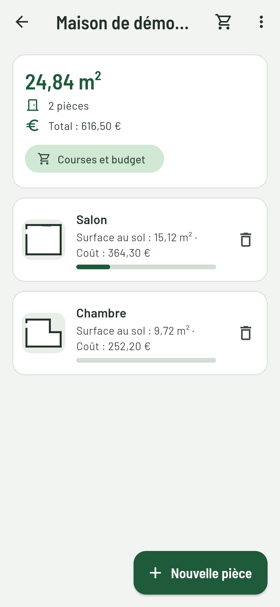

# Atelier

Application Android pour préparer ses travaux sans erreur : coupes, quantités et budget d'un chantier. Elle commence par le parquet et les plinthes ; la peinture, le carrelage, le placo, l'électricité et la plomberie suivront.

Tout reste sur le téléphone, sans compte ni connexion.

## Aperçu

| Chantier | Reprises | Parquet | Plan de pose | Plinthes |
|---|---|---|---|---|
|  |  |  |  |  |

| Peinture | Conseil | Calculs | Étagère |
|---|---|---|---|
|  |  |  |  |

Captures faites sur un chantier fictif par le workflow Captures (`test/captures/`), à chaque changement d'interface. Les nouvelles versions sont dans l'artefact `captures` de son dernier passage.

## Avancement

| Lot | Contenu | État |
|---|---|---|
| 0 | Squelette, CI, APK | fait |
| 1 | Saisie d'une pièce mur par mur, plan | fait |
| 2 | Parquet : surface, paquets, rangées, sous-couche | fait |
| 3 | Parquet : plan de pose rangée par rangée | fait |
| 4 | Plinthes : angles et liste des coupes | fait |
| 5 | Plinthes : optimisation des barres | fait |
| 6 | Chantier de plusieurs pièces, budget, liste de courses, PDF | fait |
| 7 | Guidage pas à pas, export, finitions | fait |
| 8 | Version 0.1.0, APK jointes aux releases | fait |
| 9 | Captures d'écran | fait |
| 10 | Habillage et prise en main | fait |
| 11 | Reprises : liste à cocher, repère sur le plan, photo | fait |
| 12 | Schéma des coupes de plinthe, mesure de l'angle réel | fait |
| 13 | Sens de pose du parquet en images | fait |
| 14 | Jonction entre deux pièces, barres de seuil | fait |
| 15 | Peinture, fenêtres | fait |
| 16 | Objectif du jour et badges | fait |
| 17 | Conseils et tutos | fait |

La suite est dans [ROADMAP.md](ROADMAP.md). Le format du plan exporté est décrit dans [docs/format-plan.md](docs/format-plan.md).

## Installer

Les APK de chaque version sont jointes à sa page dans [Releases](../../releases). Prendre `app-arm64-v8a-release.apk` pour un téléphone récent.

Entre deux versions, chaque exécution de la CI produit aussi une APK (onglet Actions, artefact `atelier-apk`).

## Publier une version

1. Dans `CHANGELOG.md`, renommer `## Non publié` en `## X.Y.Z - AAAA-MM-JJ` et augmenter `version:` dans `pubspec.yaml` (le nombre après `+` à chaque fois).
2. Sur GitHub, Releases, « Draft a new release », nouveau tag `vX.Y.Z` sur `main`, puis « Publish release ».
3. La CI construit les APK et le bundle `.aab` depuis le tag et les joint à la release.

Pour le Play Store : liste à cocher dans [docs/publication-play-store.md](docs/publication-play-store.md), politique de confidentialité dans [docs/confidentialite.md](docs/confidentialite.md), images de la fiche dans `docs/play-store/` (`python tool/fiche_play.py`).

## Lancer en développement

Prérequis : Flutter 3.47 et le SDK Android.

```
flutter create --platforms=android --org fr.remiverhaeghe --project-name atelier .
flutter pub get
flutter run
```

La première commande recrée les fichiers Android qui ne sont pas versionnés (Gradle, icônes) ; elle ne touche pas au code existant. Pour l'icône et l'écran de démarrage : `dart run flutter_launcher_icons` puis `dart run flutter_native_splash:create`.

## Tester

```
flutter gen-l10n
dart format lib test
flutter analyze
flutter test --coverage
```

Les captures d'écran sont sautées par `flutter test`. Pour les refaire : `flutter test --tags captures --run-skipped --update-goldens test/captures` (la variable `FLUTTER_ROOT` doit pointer vers le SDK Flutter, pour les polices).

Les parcours de `integration_test/` tournent sur un vrai Android : `flutter test integration_test` avec un téléphone branché ou un émulateur lancé. En CI, le workflow « Tests sur émulateur » les passe sur chaque pull request.

Les règles de calcul vivent dans `lib/logic/`, sans dépendance à Flutter, et la CI exige qu'elles soient couvertes à 95 %.

## Organisation

| Dossier | Rôle |
|---|---|
| `lib/logic` | Règles de calcul en Dart pur : géométrie de la pièce, parquet, plinthes, quantités |
| `lib/storage` | Enregistrement des chantiers sur le téléphone |
| `lib/ui` | Écrans, sans règle métier |
| `lib/l10n` | Textes affichés (`app_fr.arb`) |

## Licence

[MIT](LICENSE)
